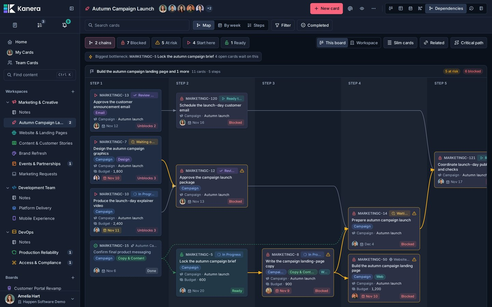
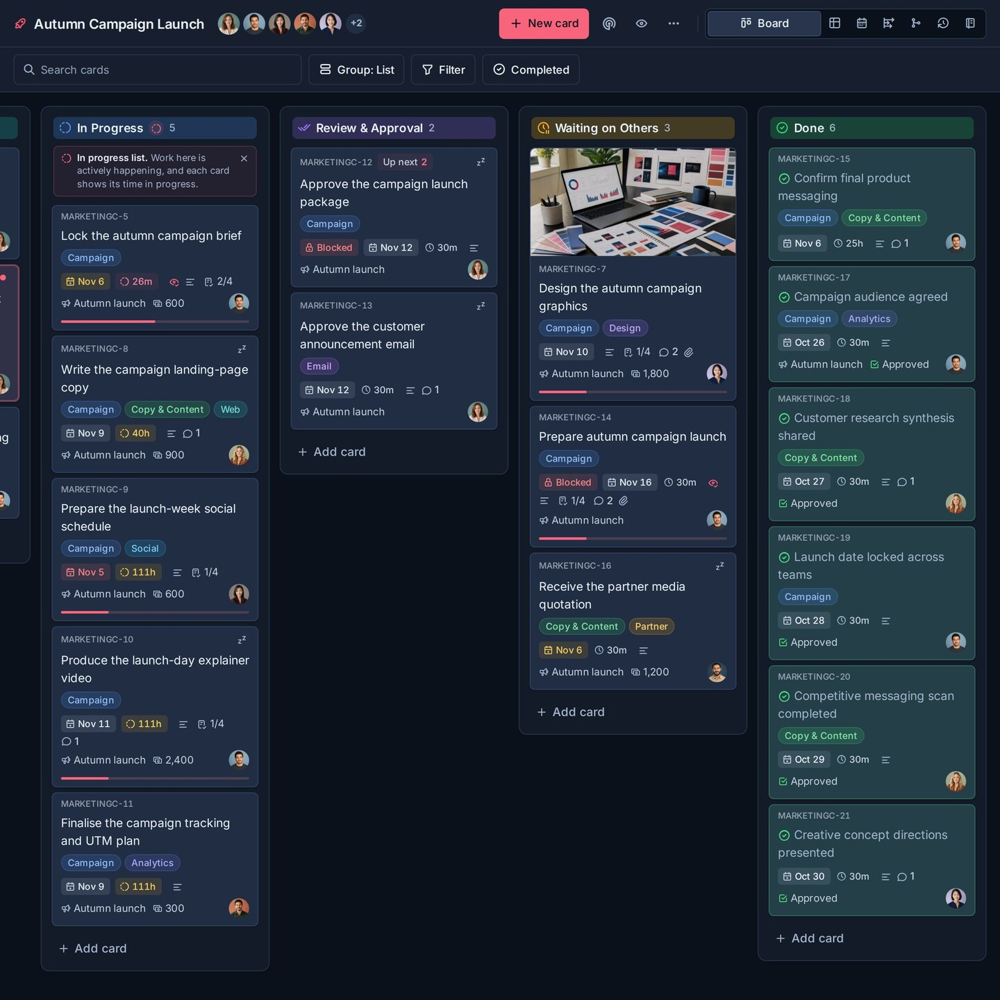
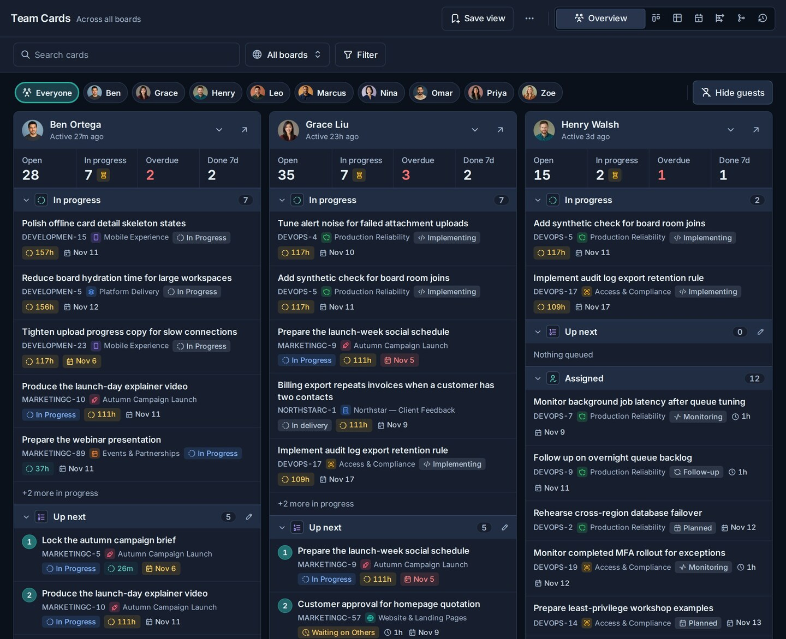
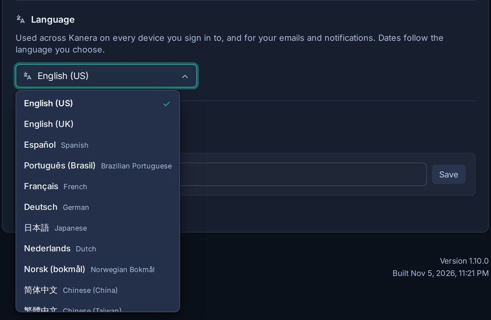

Cards can now depend on each other. Link a card as **blocked by**, **blocking** or **related** to another card, on the same board or any board in the workspace, from the **Dependencies** section in card detail or the card's right-click menu. Blocked cards say so on the board, and the **Blocked** filter on boards, My Cards and Team Cards finds them.

The new **Dependencies** view shows every blocking chain as a map, laid out by week, or as numbered steps. It names the biggest bottleneck, flags at-risk work and highlights the critical path, and you can add or remove links on the map with undo and redo.

When a card you are assigned to or watching becomes blocked or ready to start, Kanera tells you. Automations gain **Card blocked** and **Card unblocked** triggers, and completing a card that is still blocked asks you to confirm first.

## Track time in progress

Mark the lists where work actually happens as **In progress** in workspace list settings, and every card in them tracks its working time: 09:00 to 17:00, Monday to Friday, in the workspace's time zone. The total shows on the card, in card detail, in Table and in Work done.

A card in progress for too long turns amber, notifies its watchers and can trigger an automation. Workspace admins can correct a card's time if it was left in the wrong list.

## See your team at a glance

Team Cards opens on a new **Overview** with one panel per teammate: what they have in progress, longest-running first, what they worked on recently, the top of their Up next, their other open cards by due date and what they finished in the last 7 days. Select a count to expand the full list.

Work done also has a new **Report** layout on boards, My Cards and Team Cards. It sums up the period in plain language, compares key counts with the previous period, charts the daily flow, and names the cards that need attention now.

## Use Kanera in your language

Kanera is now available in English (US), English (UK), Spanish, Brazilian Portuguese, French, German, Japanese, Dutch, Norwegian Bokmål, Simplified Chinese and Traditional Chinese. Choose yours under **Profile settings**, **Language**, or from the sign-in page.

Your choice is saved to your account, so every device, email and push notification follows it, and emails show dates in your language's own order.

## New features

- [Dependencies] Link cards as blocked by, blocking or related, across boards in a workspace
- [Dependencies] A Dependencies view with blocking chains, bottlenecks and the critical path
- [Boards] A **Blocked** filter, and blocked and at-risk counts in Board overview and Portfolio
- [Automations] New **Card blocked**, **Card unblocked** and **Card in progress too long** triggers
- [Boards] Mark lists as **In progress** to track each card's working time
- [Team Cards] A Team overview with one panel per teammate
- [Work done] A **Report** layout with a summary, daily flow and breakdowns
- [Languages] Kanera is available in eleven languages
- [Home] A Getting started checklist on Home replaces the First steps card
- [Comments] Thumbs-up or reply to an uploaded file, and hear when someone likes yours
- [Notifications] Choose a notification sound: Ripple, Bloom, Pebble, the original chime or none
- [Billing] On Kanera Cloud, Plan settings show your usage against your plan's limits
- [MCP] Manage dependencies and filter blocked work from agents, the CLI, SDK and API

## Improvements

- [Appearance] Comfortable and Compact density, theme previews and accent swatches
- [Home] Home is reorganised and shows how many of your cards are blocked
- [Reporting] Date pickers offer This week, Last week, This month, Last month and Last quarter
- [Cards] Pickers work from the keyboard, and admins can create a missing label from one
- [Settings] Workspace Boards settings show each board's progress, counts and next due date
- [Performance] Faster boards, tables, card details, search, notifications and settings

## Bug fixes

- [Integrations] Board mirrors copy guests' files, and one broken card no longer stalls a mirror
- [Cards] Duplicated and mirrored cards and notes keep their images after the original is deleted
- [Cards] **Copy card link** opens the right card
- [Mobile] Pickers on phones open beside the button, and Android push notifications open the card
- [Calendar] Calendar tiles no longer cut off the due time

## Self-hosting

- Realtime WebSocket compression is now off by default; set `REALTIME_WEBSOCKET_COMPRESSION_ENABLED=true` to keep it on.
- The bundled PostgreSQL now uses `work_mem=16MB`; to change it, set `POSTGRES_WORK_MEM` and recreate the `postgres` service.
