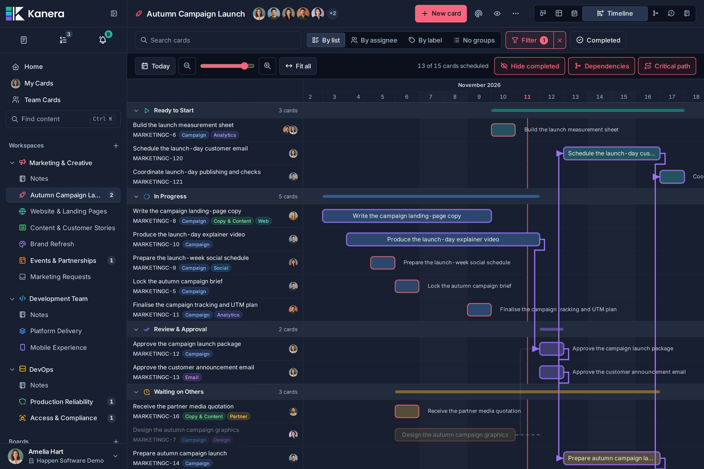
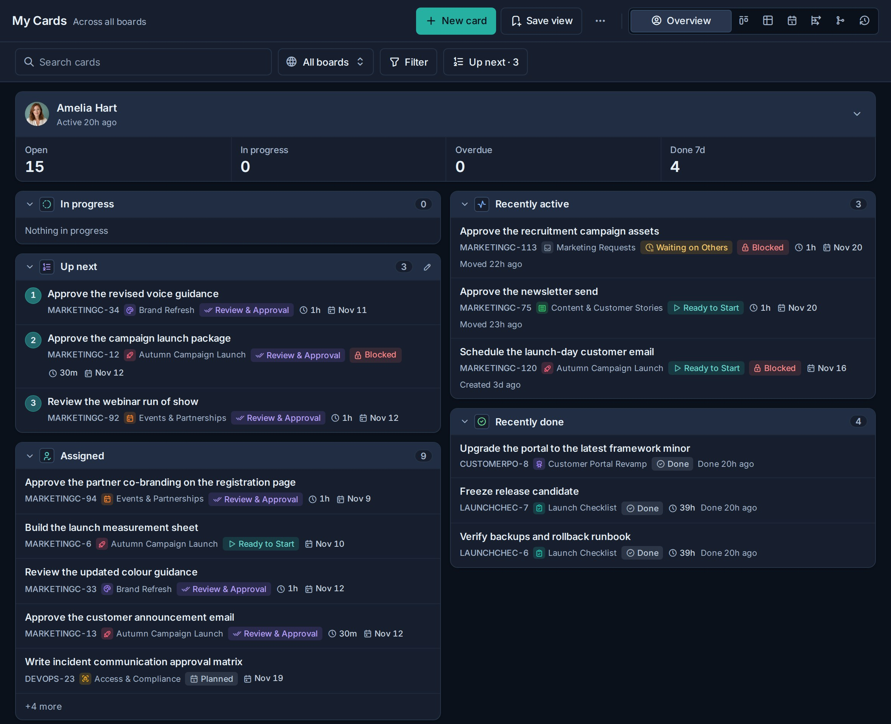
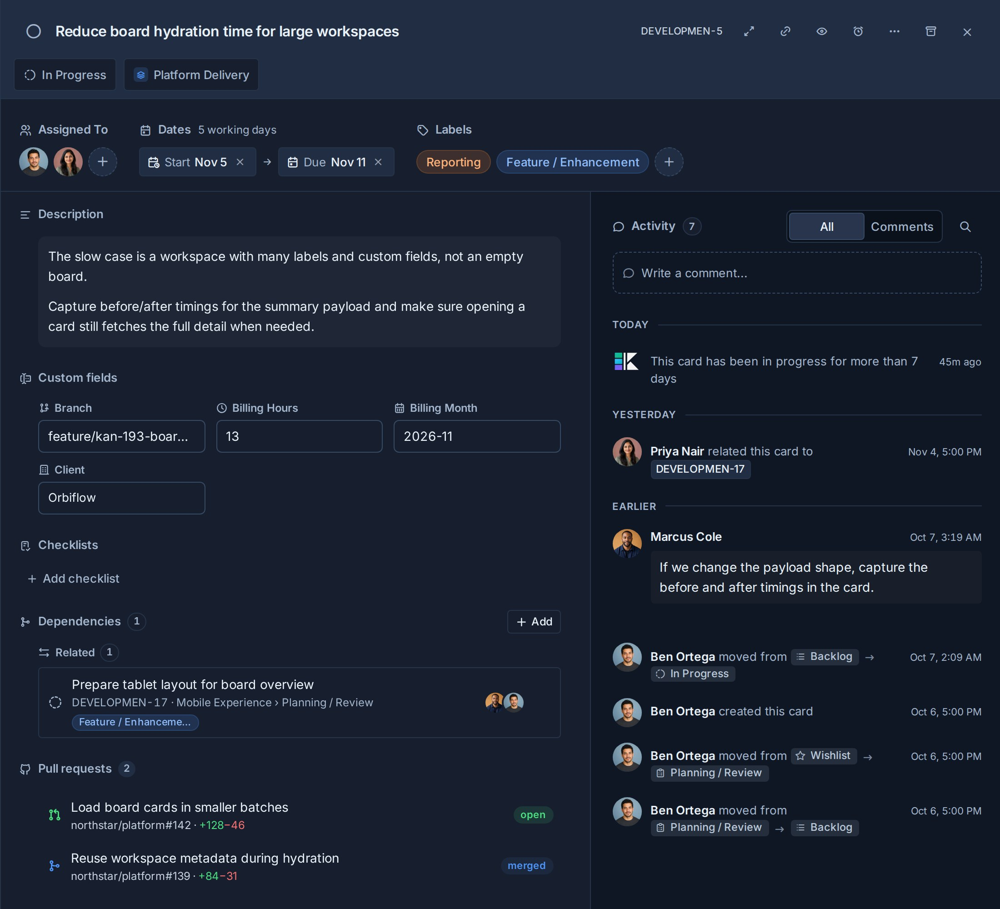

Boards have a **Timeline** view: one bar per card from its start date to its due date, grouped by list, assignee or label. Drag a bar to reschedule it, pull either end to change its length, and click an empty lane to place a card that has no dates yet. Press `7` to switch to it.

Zoom from days to years with the buttons, the slider, Ctrl + scroll or a trackpad pinch, or choose **Fit all** to see every scheduled card at once. Drag from the end of one bar onto another card and the second waits on the first.

## Start dates and the critical path

Cards can carry a planned start date next to their due date, and card detail shows how many working days sit between them. A start can never fall after the due date: moving the due date earlier pulls the start along.

Turn on **Critical path** to highlight the chain of work with no slack and see how far every other card could slip. A card planned to start before one of its blockers finishes is flagged as a scheduling conflict, and its assignees and watchers hear about it once. New automation triggers fire when a start date arrives, a conflict appears or the critical path slips.

The Timeline is also a display on **My Cards** and **Team Cards**, across every board in scope. Teams that don't plan by date can switch dependencies, start dates and time in progress off for an organisation or workspace; nothing is deleted, and turning them back on restores everything.

## Your own overview on My Cards

**My Cards** has an **Overview** display, like the one on Team Cards but for your work alone. It shows what you have in progress and for how long, what you touched recently, the head of your Up next queue, your other open cards and what you finished in the last 7 days. Each count opens the full set of cards.

In Up next you can now Ctrl/⌘-click or Shift-click several rows and drag them as one, and every row has a **Move to top** button.

## Pull requests on cards

With the GitHub App connected, a pull request whose branch, title or description names a card key, such as `KAN-123`, appears in that card's **Pull requests** section and its activity. Its state stays current as it moves from draft to open, merged or closed. **Copy branch name** in card detail gives you a branch name that links itself.

## New features

- [Timeline] A Gantt-style board view with drag-to-reschedule, zoom and Fit all
- [Timeline] Critical path, slack and scheduling conflicts between dependent cards
- [Cards] Planned start dates, shown in card detail, the table and exports
- [My Cards] An Overview display of your own in-progress, queued and finished work
- [Team Cards] Timeline display across every board in scope
- [Settings] Switch dependencies, start dates or time in progress off per organisation or workspace
- [Automations] Start date arrives, Scheduling conflict appears and Critical path slips triggers
- [Integrations] GitHub pull requests that name a card key appear on the card
- [Editor] Mermaid code blocks render as diagrams in descriptions, notes and Markdown previews
- [Notifications] A Mentions tab listing every comment that mentions you
- [Notifications] Thumbs-up a mention straight from the notification
- [Comments] Deleting a comment shows Undo before it disappears for everyone
- [Cards] An Agents filter in card activity for changes made by AI agents
- [Up next] Select several rows, drag them together and move them to the top
- [Dependencies] Unlink a dependency from its connector on the map, with Undo
- [Editor] Shortcuts for inline code, links and clearing formatting
- [AI agents] The work.schedule tool returns a board's Timeline schedule and critical path
- [Self-hosting] A one-command installer with automatic secrets and optional HTTPS

## Improvements

- [Appearance] A cleaner, more consistent look across boards, views, menus and card detail
- [Mobile] Phones use the full screen width, with navigation behind a menu button
- [Automations] Example automations rebuilt around real team workflows and your own lists
- [Automations] In-progress limits can use hours, days or a number field such as an estimate
- [Performance] Card activity, notifications, Calendar and Dependencies load faster on busy boards
- [Performance] Card detail sections render independently and reload only what changed
- [Offline] Timeline, Dependencies, Work done and Up next stay readable offline
- [Appearance] Kanera's own messages show the Kanera logo instead of a generic avatar
- [Boards] Toolbar buttons keep their labels whenever the row has room

## Bug fixes

- [Editor] Text no longer disappears or reverts after reconnecting or reopening an editor
- [Scratchpad] A background reload no longer replaces your text or moves the cursor
- [Comments] A failed comment save shows an error and keeps your draft
- [Boards] A teammate's change no longer shifts lists under a card you're dragging
- [Boards] Undo after Archive all cards restores the cards
- [Cards] A failed move no longer overwrites a teammate's newer move
- [Notifications] Deleting a comment removes the notifications it created
- [Work done] Cards completed by automations count as done for their assignees
- [Editor] Numbered lists interrupted by bullets keep their numbering
- [Comments] Reply, Edit, Delete and thumbs-up are always visible on touch screens

## Self-hosting

- The web app now publishes on `127.0.0.1:4200`. If something on the server already uses that port, set `WEB_BIND_PORT` before upgrading.
- GitHub pull requests on cards need `GITHUB_APP_WEBHOOK_SECRET` and the App's webhook URL; see `DEPLOY.md`.
